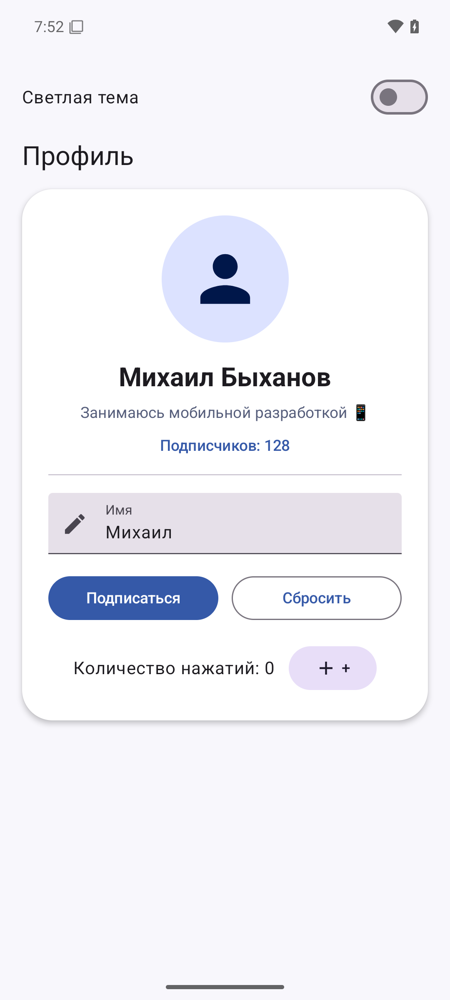

# Profile App — экран профиля на Jetpack Compose

## Описание
Учебное Android-приложение с интерактивным экраном профиля. Реализованы редактирование имени, подписка, счётчик нажатий и переключение цветовой темы.

## Скриншот


## Технологии
- Kotlin 2.0.20
- Jetpack Compose и Material 3
- Android Gradle Plugin 8.6.1
- Gradle 8.9
- Минимальная версия Android: API 24
- JDK 17

## Функциональность
- Круглый аватар с иконкой пользователя.
- Имя, статус и изменяемое количество подписчиков.
- Кнопка «Подписаться» / «Отписаться» с анимацией цвета.
- Поле ввода обновляет имя профиля сразу при наборе.
- Кнопка «Сбросить» возвращает имя по умолчанию.
- Кнопка «+» увеличивает счётчик нажатий.
- Переключатель меняет светлую и тёмную темы.

## Сборка и запуск
Откройте проект в Android Studio и запустите приложение на устройстве или эмуляторе Android 7.0 и новее.

Командная строка Windows:
```powershell
.\gradlew.bat clean build
```

## Структура
- app/src/main/java/com/example/profile/MainActivity.kt — Activity и хост темы.
- app/src/main/java/com/example/profile/data/User.kt — модель пользователя.
- app/src/main/java/com/example/profile/ui/ProfileScreen.kt — экран и состояние.
- app/src/main/java/com/example/profile/ui/components/ — аватар, данные, действия и переключатель темы.
- app/src/main/java/com/example/profile/ui/theme/Theme.kt — светлая и тёмная палитры.

## Автор
Быханов Михаил Сергеевич, группа ПИН-б-о-24-1(1), курс 3.

## Лицензия
MIT. См. LICENSE.
