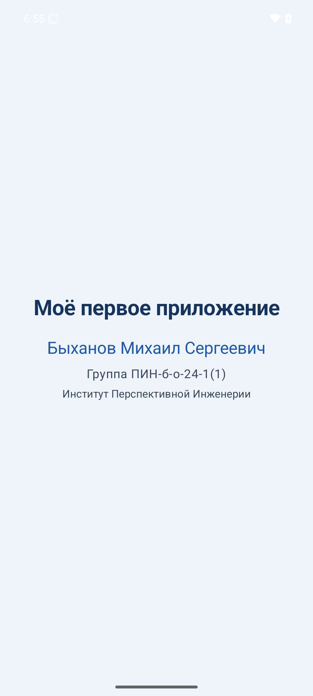

# Hello Compose — первое приложение на Jetpack Compose

## Описание проекта
Учебное Android-приложение для знакомства с Jetpack Compose. Главный экран показывает название приложения, ФИО студента, группу и институт.

## Скриншот


## Технологии
- Kotlin 2.0.20
- Jetpack Compose и Material 3
- Android Gradle Plugin 8.6.1
- Gradle 8.9
- Минимальная версия Android: API 24 (Android 7.0)
- Целевая версия: API 35

## Сборка и запуск
1. Установите Android Studio и JDK 17 или новее.
2. Клонируйте репозиторий:
   ```bash
   git clone https://github.com/soMajoz/android-compose-hello.git
   ```
3. Откройте каталог проекта в Android Studio и дождитесь синхронизации Gradle.
4. Запустите эмулятор или подключите устройство с Android 7.0 или новее.
5. Нажмите **Run** (`Shift+F10`).

Сборка из командной строки Windows:
```powershell
.\gradlew.bat clean build
```

## Структура проекта
- `app/src/main/java/com/example/hello/MainActivity.kt` — Activity и Compose UI.
- `app/src/main/java/com/example/hello/ui/theme/` — тема приложения.
- `app/src/main/AndroidManifest.xml` — манифест приложения.
- `screenshots/main_screen.png` — скриншот запущенного приложения.

## Автор
**Быханов Михаил Сергеевич**  
Группа **ПИН-б-о-24-1(1)**, Институт Перспективной Инженерии.

## Лицензия
MIT. См. файл [LICENSE](LICENSE).
