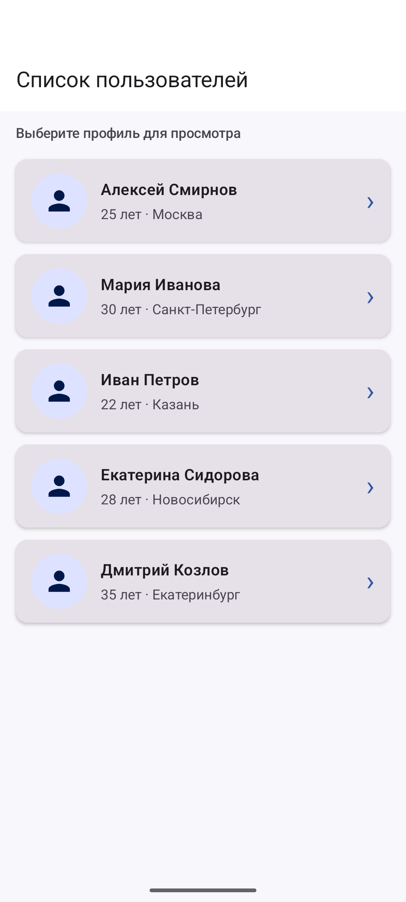
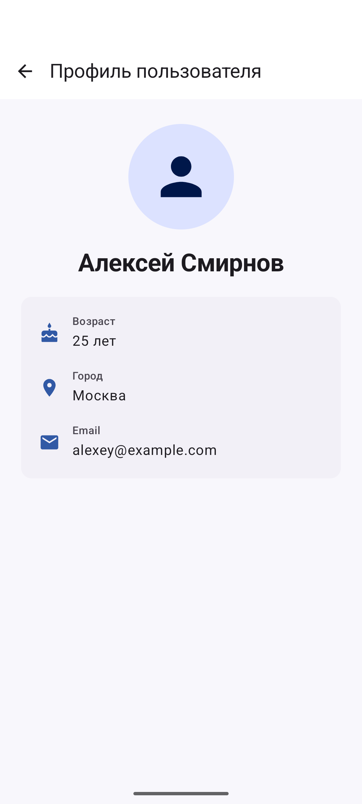

# Navigation App — навигация в Jetpack Compose

## Описание
Двухэкранное Android-приложение показывает список демонстрационных пользователей и подробную информацию о выбранном профиле.

## Скриншоты



## Функциональность
- Список из пяти пользователей в `LazyColumn`.
- Переход к профилю по нажатию на карточку.
- Передача числового `userId` через аргумент маршрута Navigation Compose.
- Детальный экран с именем, возрастом, городом и email.
- Возврат к списку через кнопку «Назад».
- Сохранение прокрутки списка средствами `LazyListState`.
- Логи основных callback-ов Activity для наблюдения за жизненным циклом.
- `@Preview` для экранов и отдельных компонентов.

## Технологии
- Kotlin 2.0.20 и Jetpack Compose
- Material 3
- Navigation Compose 2.7.7
- Android Gradle Plugin 8.6.1, Gradle 8.9, JDK 17
- Минимальная версия Android: API 24

## Сборка и запуск
Откройте эту папку в Android Studio или выполните в PowerShell:

```powershell
.\gradlew.bat clean build
```

## Структура
- `app/src/main/java/com/example/navigation/data/` — модель и демонстрационные данные.
- `app/src/main/java/com/example/navigation/components/` — карточки списка и деталей, аватар.
- `app/src/main/java/com/example/navigation/screens/` — экраны списка и профиля.
- `app/src/main/java/com/example/navigation/navigation/NavGraph.kt` — маршруты и аргументы.

## Автор
Быханов Михаил Сергеевич, группа ПИН-б-о-24-1(1), курс 3.

## Лицензия
MIT. См. LICENSE.