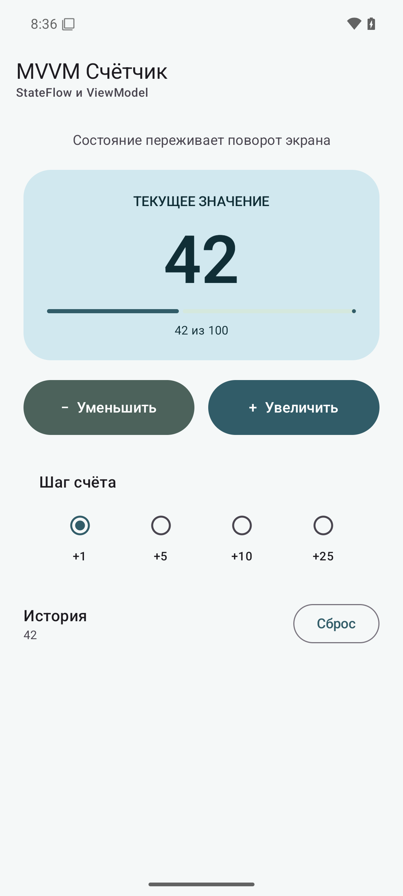
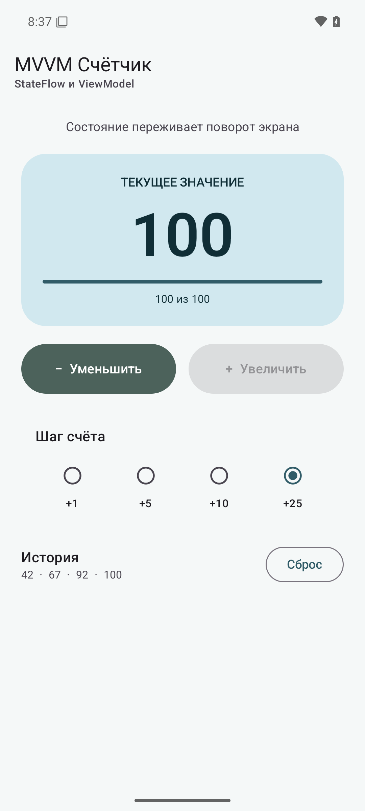

# ЛР 5 — MVVM и StateFlow: счётчик

Учебное Android-приложение показывает разделение UI и логики через ViewModel и StateFlow.

## Возможности

- асинхронная загрузка начального значения 42;
- увеличение и уменьшение с шагом 1, 5, 10 или 25;
- ограничение диапазона 0–100;
- анимация числа и история последних изменений;
- сохранение счёта и шага при повороте экрана; ключевые значения также подключены к SavedStateHandle.

## Технологии

Kotlin, Jetpack Compose, Material 3, MVVM, StateFlow, SavedStateHandle, Coroutines.

## Сборка и запуск

Откройте каталог в Android Studio или выполните команду:

    .\gradlew.bat assembleDebug

Установите app/build/outputs/apk/debug/app-debug.apk на устройство или эмулятор с API 24+.

## Скриншоты

Начальное состояние:

Максимальное значение и шаг 25:

Состояние после поворота экрана:

## Автор

Быханов Михаил Сергеевич, ПИН-б-о-24-1(1).