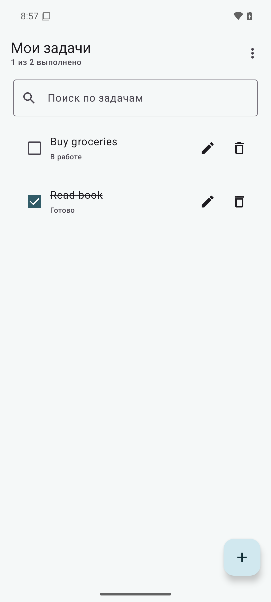

# ЛР 6 — Список задач с Room

Android-приложение сохраняет задачи в локальной SQLite-базе через Room.

## Возможности

- добавление, редактирование, отметка выполнения и удаление задач;
- реактивный список, который обновляется из Room Flow;
- поиск по названию и сортировка по дате, алфавиту или статусу;
- хранение задач после перезапуска приложения.

## Технологии

Kotlin, Jetpack Compose, Material 3, MVVM, Room 2.6.1, Flow, Coroutines.

## Сборка и запуск

Откройте каталог в Android Studio или выполните:

    .\gradlew.bat assembleDebug

Установите app/build/outputs/apk/debug/app-debug.apk на устройство или эмулятор с API 24+.

## Скриншоты

На эмуляторе проверены создание и редактирование задач, переключение статуса, поиск, три варианта сортировки, удаление и сохранение записей после принудительной остановки и повторного запуска.

## Автор

Быханов Михаил Сергеевич, ПИН-б-о-24-1(1).
