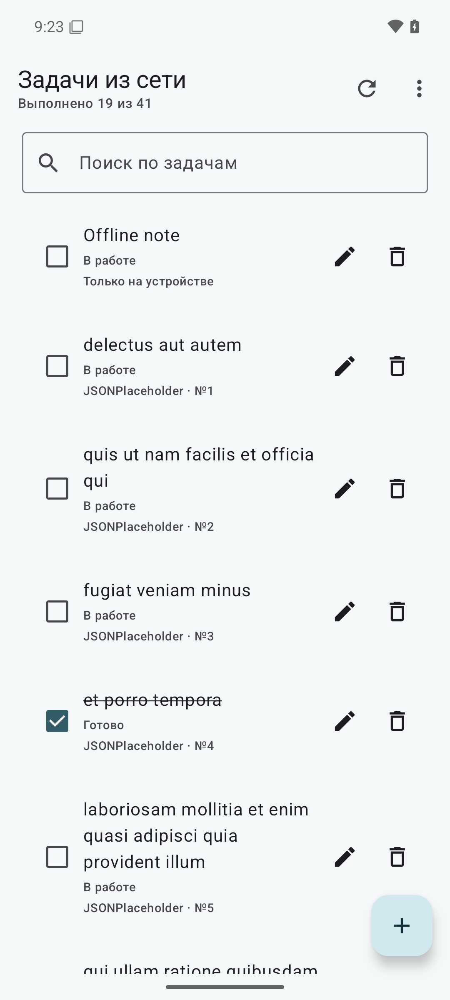
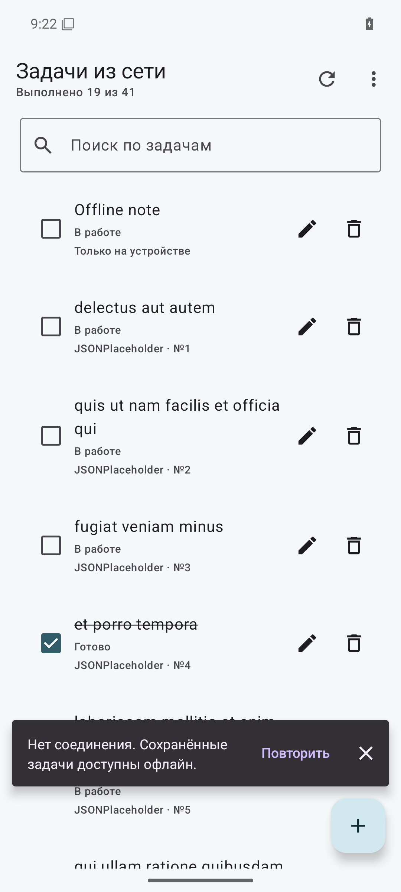

# ЛР 7 — To-Do с сетью и локальным кешем

Android-приложение загружает задачи из JSONPlaceholder через Retrofit, сохраняет их в Room и показывает локальные данные во время сетевой ошибки.

## Возможности

- автоматическая загрузка первой страницы при запуске и ручное обновление;
- пагинация по 20 задач с записью страниц в Room;
- реактивный список через Room `Flow`, поиск и сортировка;
- добавление, редактирование, завершение и удаление локальных задач;
- индикаторы загрузки и Snackbar с повтором запроса;
- доступ к кешу и локальным задачам без сети.

JSONPlaceholder — демонстрационный API. Приложение использует GET-запросы; локальные изменения остаются на устройстве и не синхронизируются с сервером.

## Технологии

Kotlin, Jetpack Compose, MVVM, Coroutines, Room 2.6.1, Retrofit 2.11.0, OkHttp 4.12.0, `kotlinx.serialization` 1.7.3.

## Сборка и запуск

Выполните из каталога проекта:

    .\gradlew.bat clean assembleDebug

Установите `app/build/outputs/apk/debug/app-debug.apk` на эмулятор или устройство с API 24+.

## Скриншоты

Список из Room после сетевого обновления:

Кеш и локальная запись после перезапуска без сети:

## Автор

Быханов Михаил Сергеевич, группа ПИН-б-о-24-1(1).
