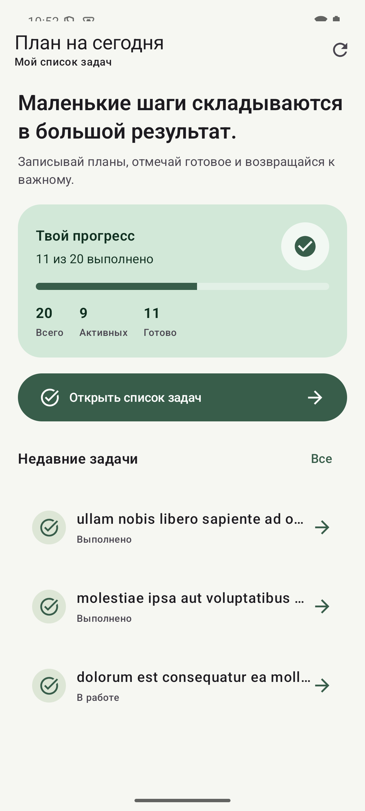
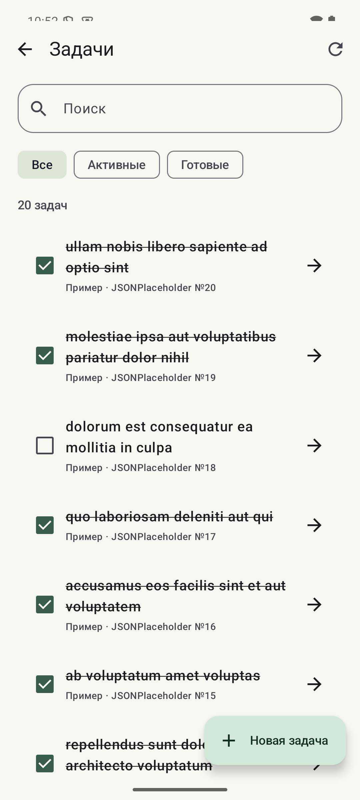
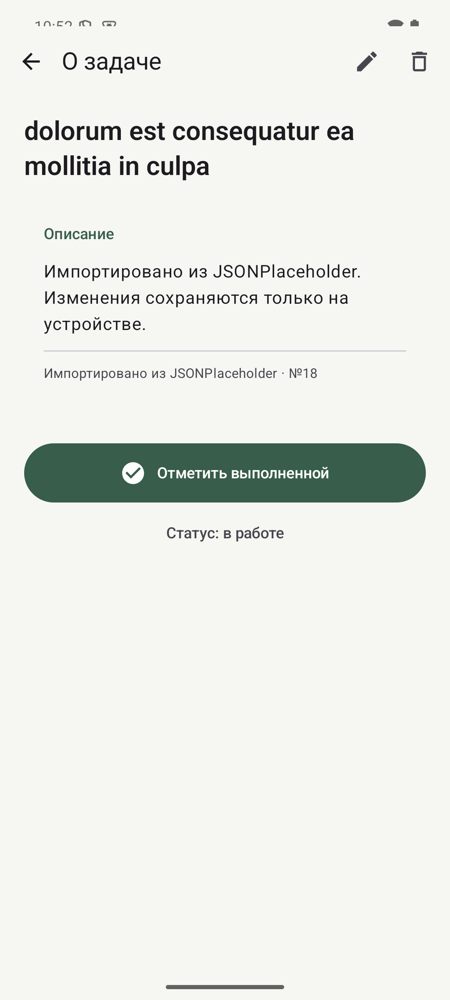

# Итоговый To-Do

Финальный проект по дисциплине «Программирование мобильных устройств»: Android-приложение для списка задач, которое объединяет локальное хранение, реактивное состояние и демонстрационную загрузку данных из сети.

- **Студент:** Быханов Михаил Сергеевич
- **Группа:** ПИН-б-о-24-1(1)
- **Вариант:** 1 — To-Do с базой данных и сетью

## Возможности

- Главный экран показывает общий прогресс и недавние задачи.
- Список поддерживает поиск, фильтры «Все», «Активные» и «Готовые».
- На экране задачи можно изменить описание и название, переключить статус или удалить запись.
- Room хранит локальные задачи и импортированные примеры, поэтому сохранённый список доступен без сети и после перезапуска.
- Retrofit загружает до 20 демонстрационных задач с JSONPlaceholder и сохраняет их в Room.
- Ошибка сетевой загрузки отображается в интерфейсе; она не скрывает локальный список.

> Сетевой API используется только для чтения примеров. Добавление, изменение, завершение и удаление задач выполняются локально и на сервер не отправляются.

## Технологии

- Kotlin 2.0.20, Android SDK 35, minSdk 24
- Jetpack Compose и Material 3
- Navigation Compose 2.7.7
- MVVM, `ViewModel`, `StateFlow` и Coroutines
- Room 2.6.1
- Retrofit 2.11.0, kotlinx.serialization и OkHttp 4.12.0

## Архитектура

```text
Compose UI → TaskViewModel (StateFlow) → TaskRepository → Room / TaskDao
                                                       ↘ Retrofit → JSONPlaceholder
```

UI наблюдает задачи из Room. При импорте Repository преобразует удалённые DTO в сущности Room; дальнейшие изменения интерфейса снова поступают из локального потока базы данных.

## Сборка и запуск

Откройте папку проекта в Android Studio либо выполните из неё:

```powershell
.\gradlew.bat assembleDebug
```

В Linux/macOS:

```bash
./gradlew assembleDebug
```

APK после сборки: `app/build/outputs/apk/debug/app-debug.apk`. Для первой загрузки демонстрационных примеров требуется подключение к интернету. Уже сохранённые задачи доступны офлайн.

## Скриншоты

| Главный экран | Список задач | Детали задачи |
| --- | --- | --- |
|  |  |  |

## Документация

- [Рефлексивный отчёт](REPORT.md)
- В этой папке — описание архитектуры и запуск проекта.

Официальные справочники: [Jetpack Compose](https://developer.android.com/jetpack/compose), [Room](https://developer.android.com/training/data-storage/room), [Retrofit](https://square.github.io/retrofit/).
